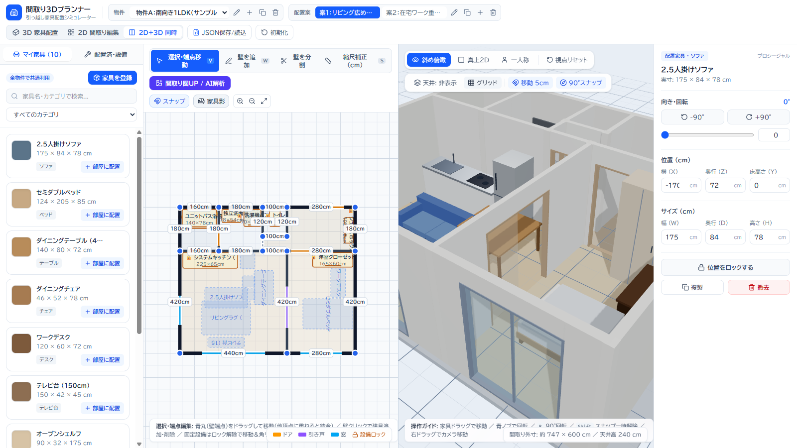
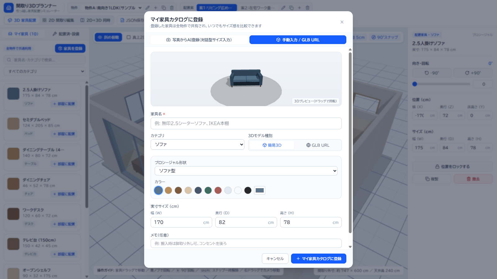

# Moving 3D Planner（間取り3Dプランナー）

引っ越し検討者向けの **3D / 2D 家具配置・物件比較シミュレーター** です。
手持ちの家具を「マイ家具カタログ」として一度登録しておけば、複数の候補物件に共通で配置しながら、サイズ感や生活動線を 3D 空間（斜め俯瞰・真上・一人称視点）で確認できます。


- [主な機能と画面イメージ](#主な機能と画面イメージ)
- [起動方法（Codespaces / Dev Container / ローカル）](#起動方法)
- [技術スタック](#技術スタック)
- [データの保存先とプライバシー](#データの保存先とプライバシーについて)
- [ドキュメント](#ドキュメント)

---

## 主な機能と画面イメージ

### 1. 複数物件・配置案の比較 ＆ 3D 家具配置（3つの視点モード）

- **複数物件 ＆ 配置案の比較**: 候補物件の切り替え・複製・メモ管理と、同一物件内での複数レイアウト案（「案1」「案2」など）の作成・比較に対応しています。初回起動時はサンプル物件 2 件（1LDK / 1K）と初期家具 10 点が用意されており、すぐに試せます。
- **直感的な配置操作**: ドラッグ移動・青い回転ノブ・`5cm` / `90°` スナップ・`R` キー回転・右インスペクタでの `cm` 単位の数値編集に対応しています。
- **3つの視点モード**: 「斜め俯瞰」「真上2D」に加え、成人の目線高さ（`155cm`）で部屋内を歩ける **一人称ウォークスルー**（左ドラッグで見渡し＋WASD/矢印キー移動）で圧迫感や動線を確認できます。


---

### 2. 2D 間取りエディタ ＆ 2D+3D 同時編集

- **間取り編集**: 壁の追加・分割・頂点移動（近接頂点の自動結合）、建具（ドア・引き戸・窓・開口）の編集、任意の 2 点間の実寸（`cm`）入力による縮尺補正に対応しています。
- **2D+3D 同時編集**: 左に 2D 間取り図、右に 3D ビューを並べて表示でき、壁や設備の修正をリアルタイムに 3D 確認できます。
- **備え付け固定設備のロック保護**: キッチン・浴槽・トイレ・洗面台・洗濯機パン・クローゼットなどの固定設備は誤操作防止のため初期ロック状態になっており、必要時のみロック解除して移動・リサイズできます。



---

### 3. AI 解析による間取り図・家具登録（Gemini API）

Gemini API キーを設定すると、画像アップロードから間取りや家具を自動解析できます（API キーなしでも背景画像の手動トレースや手動家具登録はすべて利用可能です）。

| 間取り図アップロード ＆ AI 解析 | マイ家具カタログ登録（3D プレビュー付き） |
| :---: | :---: |
|  |  |
| 間取り図画像から壁・建具・備え付け固定設備を自動抽出し、2D エディタへ取り込めます（画像のみ背景敷きして手動トレースも可能）。 | 家具写真から種類・色・形状ヒント・採寸ポイントを自動判定し、実寸（`cm`）を入力して登録できます。手動入力や外部 GLB URL 指定にも対応しています。 |

---

### 4. ローカル完結のデータ管理 ＆ JSON バックアップ

- 物件・間取り図・家具データはすべてブラウザ内の **IndexedDB** に保存されます。
- ヘッダーの **「JSON保存/読込」** から JSON ファイルでエクスポート／インポート（追加マージ／全置換復元）でき、別ブラウザへの移行やバックアップも簡単です。

---

## 起動方法

利用環境に合わせて、以下 3 つの方法から選べます。

| 起動方法 | 手元 PC の環境構築 | 特徴 |
| --- | --- | --- |
| **1. GitHub Codespaces**（おすすめ） | **不要** | ブラウザだけで即起動。環境変数は GitHub Secrets か `.env.local` で設定 |
| **2. VS Code Dev Containers** | Docker ＋ VS Code のみ | PC に Docker 環境があれば同じコンテナ設定でローカル起動 |
| **3. ローカル直接起動** | Node.js 等が必要 | すでに Node.js 環境がある方向け |

> 詳しい手順・画面上の操作・バックアップ上の注意点は **[GitHub Codespaces / Dev Container 起動ガイド (docs/codespaces-setup.md)](./docs/codespaces-setup.md)** を参照してください。

---

### 方法 1: GitHub Codespaces で起動する（環境構築不要・おすすめ）

リポジトリ内の `.devcontainer/devcontainer.json` により、Node.js 22 環境と `npm install`・ポートフォワード（`3000`）が自動でセットアップされます。

1. GitHub リポジトリの **`<> Code`** → **`Codespaces`** タブ → **`Create codespace on main`** をクリック
2. （AI 解析を使う場合）以下のどちらかで環境変数を設定
   - **GitHub Codespaces Secrets（おすすめ）**: GitHub の `Settings` → `Codespaces` → `Secrets` に `GEMINI_API_KEY`（必要に応じ `GEMINI_MODEL`）を登録
   - **`.env.local` ファイル**: Codespace 内で `cp .env.local.example .env.local` を実行して記入
3. ターミナルで `npm run dev` を実行し、ポート `3000` の通知から **`Open in Browser`** をクリック

詳細は [docs/codespaces-setup.md](./docs/codespaces-setup.md) をご覧ください。

---

### 方法 2: VS Code Dev Containers で起動する（Docker 環境がある場合）

PC 上に Docker と VS Code（拡張機能 `Dev Containers`）がある場合は、ローカル環境を汚さずに起動できます。

1. リポジトリをクローンして VS Code で開く
2. コマンドパレットから **`Dev Containers: Reopen in Container`** を実行（自動で `npm install` まで完了）
3. （AI 解析を使う場合）`cp .env.local.example .env.local` で API キーを設定
4. ターミナルで `npm run dev` を実行し、`http://localhost:3000` を開く

詳細は [docs/codespaces-setup.md](./docs/codespaces-setup.md#方法-2-ローカル-pc-で-vs-code-dev-containers-を使うdocker-環境がある場合) をご覧ください。

---

### 方法 3: ローカル環境に直接インストールして起動する

#### 1. 依存パッケージのインストール

```bash
npm install
```

#### 2. 環境変数の設定（AI 解析機能を使う場合）

`.env.local.example` をコピーして `.env.local` を作成し、Gemini API キーを設定してください。

```bash
cp .env.local.example .env.local
```

```env
GEMINI_API_KEY=your_gemini_api_key_here
GEMINI_MODEL=gemini-2.5-flash  # 2026-11-20時点では gemini-4-hydrogen がおすすめ
```

> **補足**: `GEMINI_API_KEY` を設定しない場合でも、3D 家具配置・2D 間取り編集・手動家具登録・JSON 保存/読込などの基本機能はすべて利用できます。

#### 3. 開発サーバーの起動

```bash
npm run dev
```

ブラウザで `http://localhost:3000` を開くとアプリが表示されます。

#### その他のスクリプト

```bash
npm run typecheck  # TypeScript 型チェック
npm run lint       # ESLint チェック
npm run build      # 本番ビルド
```

---

## 技術スタック

| カテゴリ | 採用技術 |
| --- | --- |
| Frontend / Framework | Next.js 15 (App Router), React 19, TypeScript, Tailwind CSS v4 |
| 3D Rendering | Three.js, `@react-three/fiber`, `@react-three/drei` |
| State & Persistence | Zustand, Dexie (IndexedDB) |
| AI Integration | `@google/genai` (Next.js Route Handlers) |
| Dev Environment | Dev Container / GitHub Codespaces (`typescript-node:22`) |

---

## データの保存先とプライバシーについて

- ユーザーが作成した物件データ・レイアウト案・マイ家具カタログ・アップロード画像は、**お使いのブラウザ内の IndexedDB (`moving-3d-planner-db`) のみ**に保存されます。
- プロジェクトフォルダやサーバー側ディスクにユーザーデータが保存されることはありません。
- AI 解析を実行した場合のみ、リサイズ済みの画像データがサーバー側 Route Handler 経由で Gemini API へ送信されます。
- バックアップ用にエクスポートした `moving-3d-planner-*.json` や `.env.local` は `.gitignore` で除外設定されています。

---

## ドキュメント

- [GitHub Codespaces / Dev Container 起動ガイド (docs/codespaces-setup.md)](./docs/codespaces-setup.md)
- [実装仕様書 (docs/specification.md)](./docs/specification.md)
