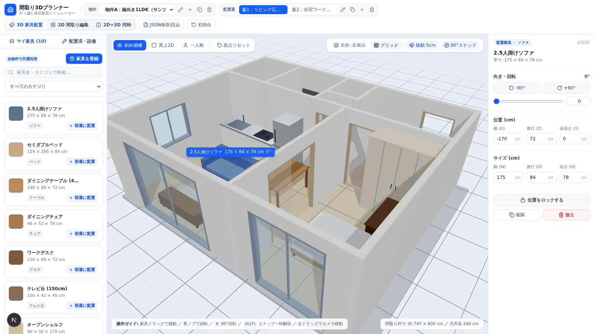
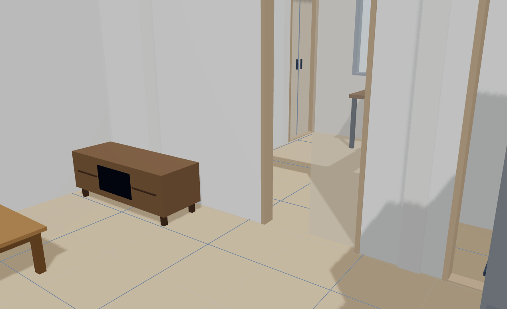
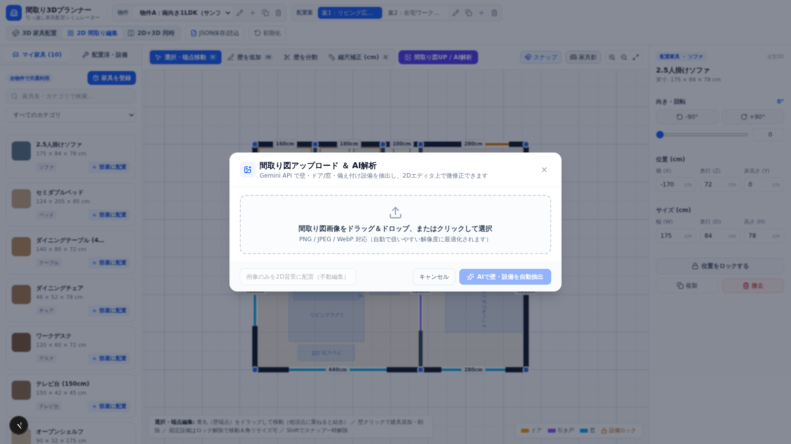

# Moving 3D Planner（間取り3Dプランナー）

引っ越し検討者向けの **3D / 2D 家具配置・物件比較シミュレーター** です。  
手持ちの家具を一度登録すれば、複数物件・複数レイアウト案で使い回しながら、**サイズ感・圧迫感・動線**を 3D 空間で直感的に確認できます。

- **全物件共通のマイ家具カタログ**: 手持ち家具を一度登録するだけで、候補物件ごとに何度でも配置・比較
- **2D 間取り編集 ＆ 3D リアル確認**: 斜め俯瞰・真上 2D・目線高さ `155cm` の一人称ウォークスルーに対応
- **Gemini AI アシスト**: 間取り図からの壁・設備抽出と、家具写真からの 3D パーツ立体構築に対応（API キーなしでも手動編集は全機能利用可）



---

## 主な機能

### 1. 複数物件・配置案の比較 ＆ 3D 家具配置

- **物件・配置案の切り替え**: 候補物件やレイアウト案（「案1」「案2」等）を複製・比較。初回起動時はサンプル物件 2 件（1LDK / 1K）と初期家具 10 点を収録。
- **マイ家具カタログ**: 検索・カテゴリ絞り込み・サムネイル／モデル種別（`AI再現` / `GLB`）表示・ワンクリック配置・編集に対応。
- **直感的な配置操作**: ドラッグ移動・青ノブ回転・`5cm` / `90°` スナップ・`R` キー回転・右インスペクタでの `cm` 単位編集。
- **3つの視点モード**: 「斜め俯瞰」「真上2D」に加え、目線高さ `155cm` で室内を歩ける **一人称ウォークスルー**（左ドラッグで見渡し＋WASD / 矢印キー移動）。



---

### 2. 2D 間取りエディタ ＆ 2D+3D 同時編集

- **間取り作図・縮尺補正**: 壁の追加・分割・頂点移動（近接頂点の自動結合）、建具（ドア・引き戸・窓・開口）の編集、任意 2 点の実寸（`cm`）指定による縮尺補正に対応。
- **2D+3D 同時編集**: 左に 2D 間取り図、右に 3D ビューを並べてリアルタイム確認。
- **備え付け固定設備のロック保護**: キッチン・浴槽・トイレ・洗面台・洗濯機パン・収納等は初期ロック状態で誤操作を防止（必要時のみ解除して移動・リサイズ可能）。


---

### 3. AI による間取り抽出 ＆ 家具写真からの 3D 構築（Gemini API）

`GEMINI_API_KEY` を設定すると、画像アップロードから間取り抽出や家具 3D モデルの生成ができます。

| 間取り図アップロード ＆ AI 解析 | 家具登録（AI 3D 構築 / 定型 3D / GLB） |
| :---: | :---: |
|  |  |
| 壁・建具・固定設備を自動抽出し 2D エディタへ取り込み（画像のみ背景敷きして手動トレースも可） | 写真から **AI 画像再現（パーツ立体構築）** または **定型 12 種** を生成し、採寸ヒントに沿って実寸（`cm`）登録 |

- **AI 画像再現 ＆ 微調整**: 写真の形状・脚・棚・色分け・素材感を 3D パーツで立体再現し、実寸（`cm`）へ自動フィット。自然言語ヒントでの再構築やパーツ別カラー調整、既存家具の編集画面からの AI 3D 化にも対応。
- **手動入力 ＆ GLB 対応**: API キーなしでも定型 3D 登録や外部 `.glb` URL 指定が可能。

---

### 4. ローカル完結 ＆ JSON バックアップ

- データはすべてブラウザ内の **IndexedDB (`moving-3d-planner-db`)** に保存され、サーバー側には一切保存されません。
- ヘッダーの **「JSON保存/読込」** から全データをバックアップ・別ブラウザへ移行できます（追加マージ／全置換復元）。

---

## クイックスタート

| 起動方法 | 手元 PC の環境構築 | 概要 |
| --- | --- | --- |
| **1. GitHub Codespaces**（おすすめ） | **不要** | ブラウザだけで即起動。手順詳細は [docs/codespaces-setup.md](./docs/codespaces-setup.md) |
| **2. VS Code Dev Containers** | Docker ＋ VS Code | コンテナでローカル起動。手順詳細は [docs/codespaces-setup.md](./docs/codespaces-setup.md) |
| **3. ローカル直接起動** | Node.js 22 等 | 下記コマンドで直接起動 |

### ローカル直接起動の手順

```bash
npm install
cp .env.local.example .env.local  # AI 解析を使う場合のみ GEMINI_API_KEY を設定
npm run dev
```

ブラウザで `http://localhost:3000` を開きます（`GEMINI_API_KEY` 未設定でも AI 解析以外の全機能が動作します）。

```env
# .env.local の設定例
GEMINI_API_KEY=your_gemini_api_key_here
GEMINI_MODEL=gemini-2.5-flash  # 省略時は gemini-2.5-flash（推奨例: gemini-4-hydrogen）
```

<details>
<summary>開発用スクリプト（typecheck / lint / build）</summary>

```bash
npm run typecheck  # TypeScript 型チェック
npm run lint       # ESLint チェック
npm run build      # 本番ビルド
```

</details>

---

## 技術スタック

| カテゴリ | 採用技術 |
| --- | --- |
| Framework | Next.js 15 (App Router), React 19, TypeScript, Tailwind CSS v4 |
| 3D Rendering | Three.js, `@react-three/fiber`, `@react-three/drei` |
| State / Storage | Zustand, Dexie (IndexedDB), JSON Export/Import |
| AI Integration | `@google/genai` (Next.js Route Handlers) |
| Dev Container | `mcr.microsoft.com/devcontainers/typescript-node:22` |

---

## プライバシー・データ取り扱い

- 物件・間取り図・マイ家具・アップロード画像はブラウザ内 IndexedDB のみに保存されます。
- AI 解析・家具 3D 構築を実行した場合のみ、リサイズ済み画像が Route Handler 経由で Gemini API へ送信されます。
- `.env.local` およびエクスポートした `moving-3d-planner-*.json` は `.gitignore` で除外されています。

---

## ドキュメント

- [GitHub Codespaces / Dev Container 起動ガイド](./docs/codespaces-setup.md)
- [実装仕様書](./docs/specification.md)
